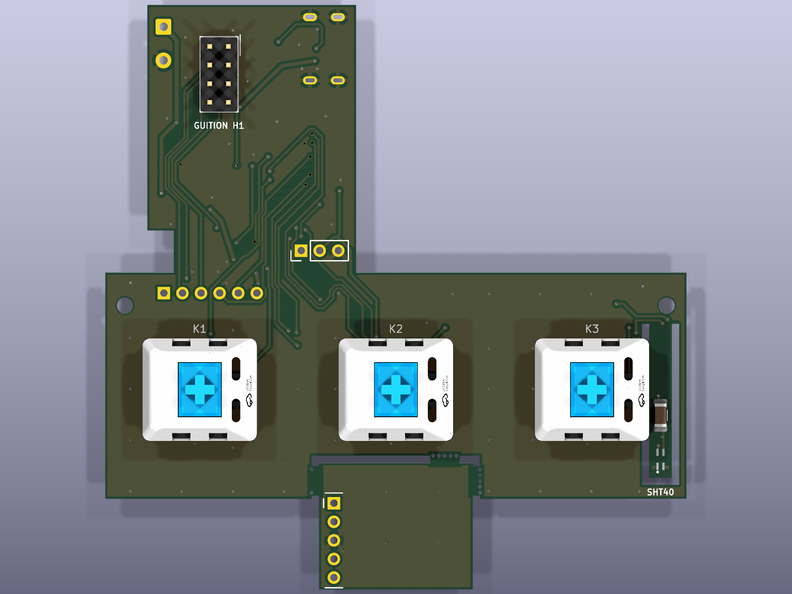
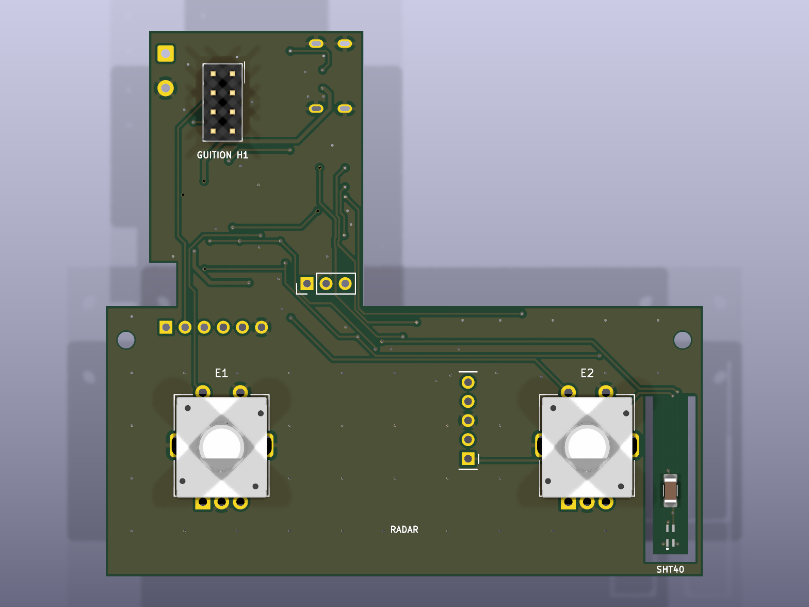
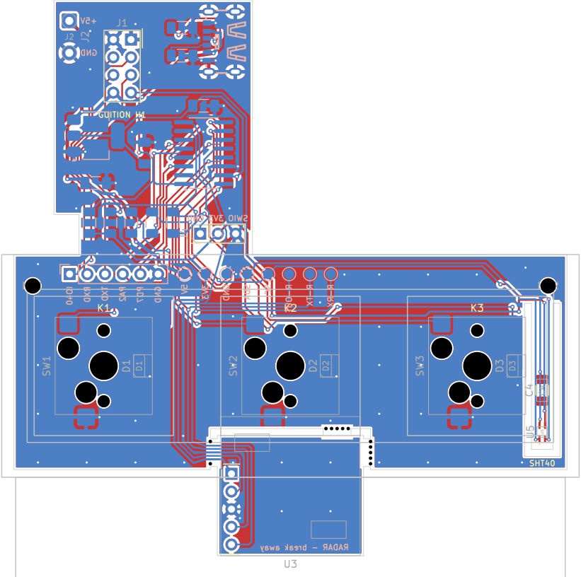
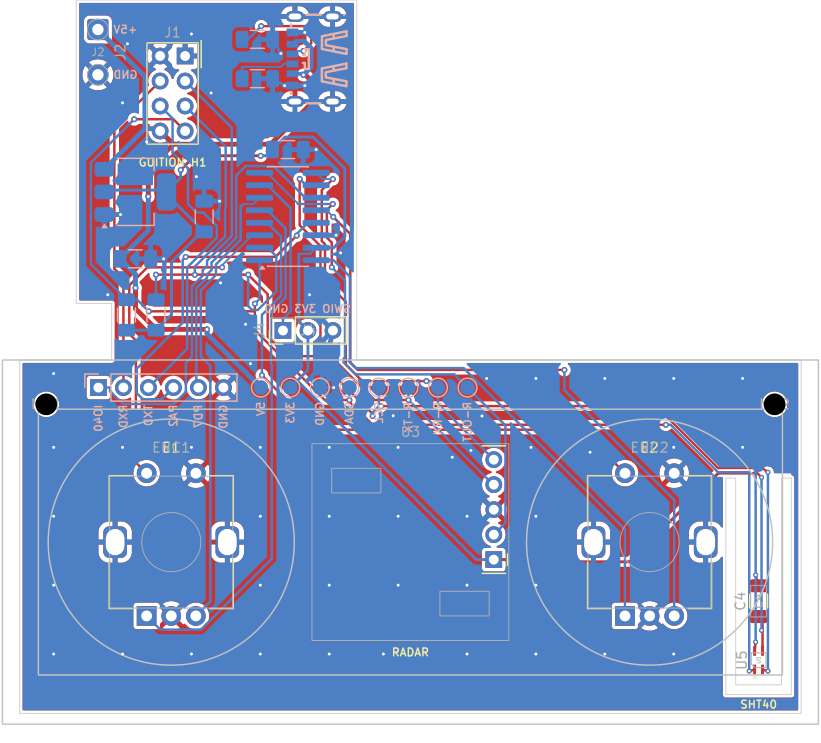

# Add-on boards for the Guition ESP32-S3-4848S040 (rev A)

Two KiCad 10 projects for a board that plugs into the 2x4 header on the back of the panel (where the 230 V power/relay module would go) and hangs below the display:
- `addon-keys`: three keys.
- `addon-encoders`: two rotary encoders.

They share everything except the bar below the display. Every KiCad file is generated by a script, using the pipeline from the LED controller project (`notes/cheap mcu AC632/rgbw-controller`). Edit the scripts, not the KiCad files, and rerun them.




**Status:** schematics, placement and routing done for both boards, DRC clean. Not ordered or built yet, so nothing is tested on a real board.
- **From Guition's own files:** the header pinout and the panel size.
- **Measured on a panel:** the header's position. The measurement agrees with a community replacement back cover to about 0.1 mm.
- **Placeholder:** the tab's outline.

**Revision:** both boards are rev A, marked on the bar's back silkscreen (`addon-keys rev A`, `addon-encoders rev A`) and in the schematic and PCB title blocks. `REV` in `addon/gen_addon.py` sets all of them. A board that changes after one has been made needs a new rev.




The overlays (User.Drawings layer) show the enclosure, its 5 mm border, and the 20 mm keycaps or the 25 mm knobs. The keys board's overlay also shows the enclosure's bottom border with the radar.

## Two boards

Keys and encoders are never fitted together. With the encoders as far apart as the enclosure allows, their pins and tab slots land on the switches' holes and pads in every rotation, about 0.16 mm short at best. So each gets its own board.

- **addon-keys:**
  - Three MX switches (HanElectricity CPG151101D13, clicky) in CPG151101S11-16 hot-swap sockets.
  - A warm-white 1206 LED in each switch's LED slot.
  - The HLK-LD2402 radar on a break-away piece centred below key 2. Snap it off for a build without the radar.
- **addon-encoders:**
  - Two Bourns PEC11R-4215F-S0024 encoders with push switches, for 25 mm knobs.
  - The radar between them. Leave it off for a build without the radar; there is no piece to snap off.
- **Both:**
  - CH32V003A4M6 co-processor, an I2C slave to the panel.
  - A bare SHT40 on a U-tab at the bar's right end.
  - 3.3 V LDO.
  - 5 V in from solder pads or an optional USB-C. The board feeds 5 V to the panel through the 2x4 header, so the panel's own USB is never connected.
  - Spare pins on solder pads (J5) and fourteen test points.

## Board (both)

- **Enclosure (front), as planned:**
  - **Width:** 82.9 mm, 2 mm a side narrower than the wall mount. The keys and encoders are still spaced for an 85.6 mm enclosure, so the side borders are 3.65 mm.
  - **Border:** 5 mm at the top and bottom, then a 1 mm gap around each keycap or knob.
  - **Height:** 32 mm for the keys and 37 mm for the encoders. With the radar, the keys board's enclosure has a radar section below that: 2 mm a side narrower again and half as tall (16 mm), 48 mm in all.
- **Bar (front, facing the room):**
  - **Width:** 79.4 mm, centred on the panel. Test-fitted, it sat flush with the panel's left edge and 0.9 mm short of its right edge. So it was trimmed 0.9 mm on the left to centre it, plus 1.1 mm on each side for the walls. It then lost 2 mm more on each side for the narrower enclosure, which leaves 1.75 mm beside it for the cover's walls and clearance.
  - **Height:** 30.9 mm on the keys board and 35.9 mm on the encoders board, ending 1.1 mm above the 5 mm bottom border.
- **SHT40 U-tab:**
  - **Where:** at the bar's right end, beside key 3 or encoder 2.
  - **Shape:** a 1 mm U-shaped slot cuts out a tongue 21 mm long: 3.1 mm wide on the keys board, 4.65 mm on the encoders board. It hangs from the top and is free at its lower end, near the bottom edge where the enclosure's vents should go.
  - **Parts:** the bare SHT40 near the free end, and C4 (100 nF) on the tongue.
  - **Distance from heat:** far from the regulator, the chip and the radar. On the keys board, key 3's LED, a few milliwatts, is the nearest heat source.
- **Panel:** 86.5 x 86.5 x 13.6 mm, from Guition's dimension drawing.
- **Panel header H1:** a 2x4 female socket with 2.54 mm pitch, its long axis vertical.
  - **Position (measured):** seen from the front, the header body starts 17 mm from the panel's left edge and 22 mm from its bottom edge. With a 5.08 x 10.16 mm body, its centre is 23.71 mm left of and 16.17 mm below the panel's centre.
  - **Cross-check:** the Printables replacement cover 1487412 has its window centred at 23.8 / 16.1 mm.
  - **Pinout (Guition schematic):** 1 GND, 2 GND, 3 IO40 (relay 1), 4 U0RXD, 5 IO2 (relay 2), 6 U0TXD, 7 IO1 (relay 3), 8 5V.
  - **Pin 1:** the top of the column nearer the panel's centre.
  - **No 3.3 V:** H1 has none, so the board has its own regulator.
  - **IO1/IO2/IO40:** they reach H1 through 0 Ω links R25-R27 on the panel. The alternative links R21-R23 route them to the audio amplifier instead.
- **H1 height:** the socket stands about 3 mm out of the panel's back, so the board's front sits 3.2 mm behind the panel's back (the wall mount allows for it).
- **J1:** the male header that plugs into H1. Its footprint numbers each pad like the H1 pin it mates with, so the schematic pin numbers are the panel's. SDA = IO1 (pin 7), SCL = IO2 (pin 5). IO40 and the ESP's UART0 (pins 3, 4, 6) go to the spare pads.
- **Spare pads and test points (back, along the bar's top edge below the tab, behind the enclosure's top border):**
  - **J5:** a row of 2.54 mm through-hole pads for wires or a header, labelled on the back. In order: IO40, RXD and TXD (the ESP's UART0, which carries its boot log), PA2 and PD7 (the co-processor's spare pins; PD7 doubles as NRST), and GND.
  - **TP1-TP8:** 1.5 mm pads on the back, 3 mm apart: 5V, 3V3, GND, SDA, SCL and the radar's TX, RX and OUT (labelled R-TX, R-RX, R-OUT). On the keys board the radar's three are in the order R-OUT, R-TX, R-RX, the order their tracks arrive in. They stay on the bar when the keys board's radar piece is snapped off.
  - **TP9-TP14:** 1.5 mm pads on the back for the keys' or encoders' own signals, each labelled beside it. They sit where the back has room next to those tracks, so they aren't all in the row:
    - **Keys board:** K1, K2 and K3 below the row, LED2 and LED3 above it on the tab, and LED1 further up the tab, between the co-processor and the resistors.
    - **Encoders board:** E1_SW, E1_B and E1_A in a second row below J5, E2_A and E2_B at the right-hand end of the row, and E2_SW above the 5V pad.
- **Alignment holes MH1 and MH2:** 2.2 mm, no copper, 37 mm left and right of the centre and 4.5 mm below the panel's bottom edge, for the wall mount's 2 mm pins.
- **Tab (behind the panel):**
  - **Size and position:** 28.5 mm wide. Its left edge stays clear of the stock back cover's screw near the panel's lower-left corner (front view, about 37 mm left of and 29 mm below the centre).
  - **Hook notch:** its lower-left corner is cut away, 3.6 mm across and 5.75 mm up from the panel's bottom edge, for the wall mount's lower-left clip hook (30.85 mm left of and 38.5 mm below the panel's centre). The resistor row starts right of it.
  - **Front:** the 2x4 header only.
  - **Back (wall side, inside the wall box):** the USB-C (opening at the tab's right edge), the 5 V wire pads, the LDO, the co-processor, the resistors and the programming pads. Keeping the heat sources here keeps them away from the SHT40.
- **Hand soldering:**
  - 1206 hand-solder pads.
  - SOT-223 regulator.
  - SOIC-16 with pads 0.8 mm longer than standard.
  - Through-hole headers and encoders.
  - The hot-swap socket pads are 2.5 x 2.55 mm.
  - The exception is the bare SHT40, a 1.5 mm DFN with its pads underneath. Its footprint has pads 0.5 mm longer than standard, so it can be tinned and reflowed from outside, but hot air or a hot plate is the reliable way. A small breakout could fit on the tongue instead if you prefer.

## Routing (both)

2 layers, 1 oz. `addon/route_addon.py` runs all of it.

- **Track widths:** `+5V` 0.5 mm, since it feeds the panel too. `+3V3` and GND 0.3 mm (about 100 mA). Signals 0.25 mm. Clearance 0.2 mm.
- **GND:** a pour on each side, joined by stitching vias about 7 mm apart. Every surface-mount GND pad has its own via, and J4's GND pad is tied to TP3 on the back, so signal tracks can't fence a pad off from the pours. Freerouting doesn't wire GND.
- **Vias:** tented on both sides. None inside pads, as those are soldered by hand.
- **SHT40 tongue:** routed by hand, with its own 0.25 mm tracks up the back and no pour on either side, so little heat reaches the sensor along the copper.
- **Everything else:** Freerouting, best of several runs, then a small A* router for anything left open. It runs on both sides of the board, including under the switches and encoders; the copper there is covered by solder mask.
- **TP9-TP14:** added to the routed boards afterwards, on or beside the tracks already there, with short tracks and one via (LED1's, on the keys board). A fresh `route_addon.py` run puts them in the same spots and routes them like any other net.

## Keys board

- **Keys:** three, spread evenly inside the border, so they are 26.8 mm apart, centred 16 mm below the panel's bottom edge. Switches turned 90 degrees, so the socket pads on the back stay inside each switch's outline and the LED slot faces right.
- **Radar (break-away piece):**
  - **Position:** centred on the bar, under key 2, as close to the keys as the switches allow. Its top edge is 0.3 mm below key 2's switch body, so its top 2.7 mm sit behind keycap 2 and the gap around it. It can't come any closer: the switch body is in the way, and between the keys there is only 12.8 mm for the 20 mm module. The bottom border with the radar shrinks to about 17.4 mm.
  - **Effect of key 2:** key 2's switch stands about 11.6 mm tall right at the radar's top edge. That shades part of its upward view; the forward view isn't affected.
  - **Break line:** steps up under the radar to just below key 2's socket, notching the middle of the bar's bottom edge, with a 1 mm gap down each side of the piece. With the piece snapped off, the notch hides behind the 5 mm border.
  - **Bridges:** three 4 mm bridges with 0.5 mm mouse-bite holes on the bar's edge line: one across each side gap and one across the top gap, right of key 2's hot-swap socket (there is no room for one on its left). The left bridge, by the radar's header column, has only its two end holes, and the radar's five tracks cross it between them, straight and all on the back: score the back with a knife before snapping, and clean up the track ends so they can't short. The pours stay off all three bridges.
  - **Radar tracks:** routed by hand from the header, across the bridge and up the back of the bar left of key 2, then along above the key sockets to the test points. The radar's GND drops to the front pour through a via just left of the bridge.
  - **Orientation:** turned 180 degrees from Hi-Link's figure 6-1, so all five header pins land on the piece; Hi-Link's manual says this orientation is equivalent. The module floats over the notch and the bridges on its 2.5 mm header.
- **SHT40:** sits below the 1 mm gap between keycap 3 and the border.

## Encoders board

- **Encoders:** as far apart as the enclosure allows. Across, it is 5 mm border, 1 mm gap, knob, the space between, knob, 1 mm gap, 5 mm border, so the centres are 18.5 mm in from each end of the enclosure and 48.6 mm apart.
- **Height:** the same from top to bottom, so the enclosure is 37 mm tall and the bar 5 mm taller than the keys board's. The encoders are centred 18.5 mm below the panel's bottom edge, 2.5 mm lower than the keys.
- **Radar:** midway between the encoders and level with them, oriented as in Hi-Link's figure 6-1 (header column on the right). Seen from the front, the knobs clear its sides by about 1.8 mm. Plastic knobs are best; metal ones beside the radar would shade its view to the sides.
- **SHT40:** below and to the right of knob 2, in the enclosure's lower-right corner, with C4 above it. Both are clear of the knob.

## Pin map (CH32V003A4M6)

| Pin | Keys board | Encoders board |
|---|---|---|
| PC1 / PC2 | I2C SDA / SCL to the panel (GPIO1 / GPIO2), 4.7k pull-ups | same |
| PD5 / PD6 | USART1 TX / RX to the radar | same |
| PD4 | radar OUT (presence) | same |
| PC6 / PC7 / PC0 | LED 1 / 2 / 3, PWM on TIM1 CH1-CH3 (remap 1) through 100 R | encoder 1 A / B, encoder 2 A |
| PC3 / PA1 / PC4 | key 1 / 2 / 3 | encoder 1 push / encoder 2 B / encoder 2 push |
| PD1 | SWIO (WCH-LinkE on J4) | same |
| PD7, PA2 | spare, on J5 | same |

The two boards use the same pins, so one firmware can serve both. It needs to know which board it's on.

## Parts

| Ref | Part | LCSC | Board |
|---|---|---|---|
| U1 | LDL1117S33R, 3.3 V LDO, SOT-223 | C435835 | both |
| U2 | CH32V003A4M6, SOP-16 | C5346357 | both |
| U3 | HLK-LD2402 radar | C48935081 | both, optional |
| SW1-SW3 | CPG151101S11-16 hot-swap socket + CPG151101D13 switch | C41430893 + C49234235 | keys |
| D1-D3 | warm-white 1206 LED, 2700-3000 K (LCSC doesn't stock one; e.g. Electrokit 40307556) | | keys |
| R5-R7 | 100 R 1206 | C17901 | keys |
| ENC1, ENC2 | Bourns PEC11R-4215F-S0024 | C143790 | encoders |
| C1, C2 | 10 uF 1206 | C7467044 | both |
| C3 | 100 nF 1206 | C93194 | both |
| R3, R4 | 4.7k 1206 (I2C pull-ups) | C17936 | both |
| J1 | 2x4 male header, 2.54 mm, into the panel's H1 (pin length: see below) | C492421 | both |
| J2 | 5 V wire pads | | both |
| J3, R1, R2 | USB-C 6P power-only, 4.7k CC pull-downs (5.1k +-20 %) | C456012, C17936 | both, optional |
| J4 | programming pads: SWIO, 3V3, GND | | not fitted |
| J5 | spare pads: IO40, RXD, TXD, PA2, PD7, GND | | not fitted |
| TP1-TP14 | test points, bare 1.5 mm pads | | both, no part |
| U5 | Sensirion SHT40-AD1B-R2 (I2C 0x44), DFN-4 1.5 x 1.5 mm. Not in LCSC's shop: see below | C2909890, for JLCPCB fitting it; DigiKey 1649-SHT40-AD1B-R2CT-ND to solder by hand | both |
| C4 | 100 nF 1206, on the SHT40 tab | C93194 | both |

## Before ordering

- **Header position:** worth a careful second measurement before ordering, since a board-to-board connector leaves no slack. It is set by `HDR_DX` and `HDR_DY` in `place_addon.py`.
- **Panel links:** check that R25-R27 (0 Ω) are fitted on your panels, so IO1 and IO2 actually reach H1. That is likely on relay units and should be checked on ones bought without relays.
- **Pin length:** H1 stands about 3 mm out of the panel's back and the board's front is 3.2 mm behind that back, so H1's mouth is only 0.2 mm from the board's front. That leaves no room for a header's 2.5 mm plastic spacer or for a solder fillet on the front. So use a standard 2x4 header (C492421: 6 mm pins, 2.5 mm spacer, 3 mm tails) like this: push the tails in from the front, solder on the back, pull the spacer off over the pin tips, then cut the pins to about 6 mm past the board's front. That goes about as deep into H1 as a normal header would. H1's actual depth hasn't been measured, so check it with a loose pin before cutting. A long-pin header with its spacer on the back, such as C7128766 (8.13 mm pins), also reaches, but it has to be soldered on the front or with the spacer held off the back.
- **Mechanics:** check how the board gets past the frame rim, and the outline.
- **Radar pinout:** check the module's print against 1 VCC, 2 OUT, 3 GND, 4 TX, 5 RX (Hi-Link manual p. 7).
- **Radar header:** the radar's pins must come out of the non-antenna side.
- **LED fit:** check that a 1206 LED fits in the switch's LED slot. From the datasheet the slot is about 9.4 x 2.7 mm.
- **SHT40:** LCSC's shop doesn't sell Sensirion's part. C2909890 only works for having JLCPCB fit it (16,586 in its parts data on 2026-11-02). To solder it by hand, buy DigiKey 1649-SHT40-AD1B-R2CT-ND: cut tape, 3,379 in stock and 17.11 kr each for 5 or more on 2026-11-02. Either plan how to solder it (hot air or a hot plate) or have JLCPCB fit just that part. LCSC does sell look-alikes named SHT40, untested here. The datasheet of Nyfea's SHT40-N-NF (C54946589, about $1) states the same address (0x44), pin order and measure command (0xFD); C55170371 and C54823945 are others.
- **Alignment test:** print `addon-keys/mockup/addon-keys-alignment.stl` or `addon-encoders/mockup/addon-encoders-alignment.stl` (`tools/export_jig_stl.py`), hot-glue a 2x4 header into it and try it on a panel. Its pin holes are opened up for printing: 1.7 mm for the 2.54 mm headers (J1, J4, J5, radar), 1.5 mm for the encoder pins, the encoder tab slots by 0.2 mm, and 2.9 mm for the wall mount's 2.0 mm alignment pins (MH1, MH2; 2.2 mm on the board).
- **JLCPCB's limits (checked against its capabilities page, 2026-10-31):** tracks, clearances, vias and annular rings are all inside them, with no surcharge for via size. Three things fall outside its guidance: the silkscreen labels are 0.8 mm tall against a 1.0 mm minimum (still 0.15 mm lines, so they should print, just small); the encoders' plated tab slots (1.9 x 2.7 mm) are shorter than the twice-their-width it asks for; and the keys board's mouse-bite bridges are 4 mm against 5 mm for its panel tabs, though it doesn't say that applies inside one design.
- **Parts lists:** [addon-keys/lcsc-order-5.csv](addon-keys/lcsc-order-5.csv) and [addon-encoders/lcsc-order-5.csv](addon-encoders/lcsc-order-5.csv) are LCSC BOM uploads for 5 boards with spares, checked against LCSC's stock, minimums and prices on 2026-11-02. They come to about $13 and $33, plus $15 if you take the 5 radars on each list: LCSC only has 11, so delete that line for any you already have. Not on them: D1-D3 and U5 (LCSC doesn't sell them; see above), keycaps and knobs, and pins for the radar if yours comes without. J4 and J5 aren't fitted.
- **Order files:** `tools/export_gerbers.py` writes `addon-<board>/production/addon-<board>-gerbers.zip` (git-ignored). Export again after any change to the board. There's no placement file yet, in case JLCPCB is to fit any parts.
- **Firmware:** still to write: the CH32V003 firmware and the ESPHome component that talks to it.

## Files

| File | What |
|---|---|
| `addon/gen_addon.py` | Schematic for either board (`keys` or `encoders`): parts, values, LCSC numbers, nets |
| `addon/place_addon.py` | Board for either board: outline (with the U-tab, and the keys board's break-away piece), placement, labels, DRC rules, enclosure overlay, pours, the GND vias and the tracks routed by hand |
| `addon/route_addon.py` | Routes either board from scratch with the tools below |
| `addon/sym-lib-table`, `addon/fp-lib-table` | Library tables, copied into each project by `gen_addon.py` |
| `addon-keys/`, `addon-encoders/` | Generated KiCad projects |
| `addon-*/renders/` | 3D renders (top, bottom, angled) and the enclosure overlay |
| `lib/addon.*` | Symbols, footprints and STEP models |
| `tools/addon_lib.py` | Makes the radar symbol and footprint, the hot-swap MX, PEC11R, SHT40 and hand-solder SOIC-16 footprints, the mouse bites, and the USB-C footprint |
| `tools/export_jig_stl.py` | The fit-test STL, with the pin holes opened up for printing |
| `tools/stitch.py` | Stitching vias between the GND pours, after routing |
| `tools/export_gerbers.py` | The Gerber and drill zip to upload to the fab |
| `tools/autoroute.py`, `tools/finish_route.py`, `tools/fanout.py` | Freerouting, the A* router for what it leaves open, and a via for each SMD GND pad, from fablights. These know these boards aren't rectangles |
| `tools/` | schgen, pcbbuild, netcheck, import_lcsc, render3d, from the LED controller project |

## Rebuild

Run from the repo root. `KPY` is KiCad's own Python, used for everything that imports pcbnew. `VENV` is the fablights venv, which has easyeda2kicad. Routing needs `freerouting-*.jar` and a Java 25 runtime (not committed) in `hardware/tools/ext/` or in a fablights checkout next to this repo.

**`place_addon.py` starts the board over, routing included.** After changing anything on the board, route it again. Freerouting varies from run to run, so the tracks will differ each time: look through the result before ordering.

```bash
KPY="/c/Program Files/KiCad/10.0/bin/python.exe"
CLI="/c/Program Files/KiCad/10.0/bin/kicad-cli.exe"
VENV=/c/Users/englund/Documents/GitHub/fablights/tools/.venv/Scripts/python.exe

"$VENV" hardware/tools/import_lcsc.py C456012 C41430893 C49234235 C143790   # STEP models (once)
python hardware/tools/addon_lib.py                                         # own symbols and footprints
"$CLI" fp upgrade --force hardware/lib/addon.pretty
for B in keys encoders; do
  P=hardware/addon-$B/addon-$B
  python hardware/addon/gen_addon.py $B                                    # schematic
  "$CLI" sch upgrade --force $P.kicad_sch
  python hardware/tools/netcheck.py $P.kicad_sch                           # ERC + single-pin nets
  python hardware/addon/route_addon.py $B                                  # board, placement and routing (a few minutes)
  "$CLI" pcb drc --schematic-parity --severity-all -o drc-$B.rpt $P.kicad_pcb
  "$KPY" hardware/tools/render3d.py addon-$B                               # renders/
  "$KPY" hardware/tools/export_jig_stl.py $B                               # fit-test STL (git-ignored)
  python hardware/tools/export_gerbers.py $B                               # Gerbers and drill for the fab (git-ignored)
done
```

**Don't run `kicad-cli sym upgrade` on `lib/addon.kicad_sym`:** kicad-cli 10.0.6 then crashes loading any schematic that embeds the upgraded radar symbol.

**Expected DRC result:**
- `lib_footprint_issues` (32 and 26), which kicad-cli prints because there's no global footprint library table on this machine.
- Nothing else. Rules in `addon-keys.kicad_dru` allow the keys board's intended overlaps: the LEDs inside the switches, and the radar over key 2's edge and the break line. The encoders board needs none.

## Sources

- Guition's support package for the panel, with the schematic (`5-IO pin distribution/2.png`), the dimension drawing (`3-Structure_Diagram/Dimensions.jpg`) and the spec PDF: <https://pan.jczn1688.com/1/ESP32%20module/4.0inch_ESP32-4848S040.zip>
- Header position measured on a panel and cross-checked against the Printables replacement back cover 1487412; board photos at <https://homeding.github.io/boards/esp32s3/panel-4848S040.htm>
- Hi-Link HLK-LD2402 manual (pins p. 7, drawing p. 37, orientation pp. 33-35): <https://www.manualslib.com/manual/4392645/Hi-Link-Hlk-Ld2402.html>
- Bourns PEC11R datasheet: <https://www.bourns.com/docs/Product-Datasheets/PEC11R.pdf>
- HanElectricity CPG151101D13 and CPG151101S11-16 drawings, from LCSC (C49234235, C41430893)
