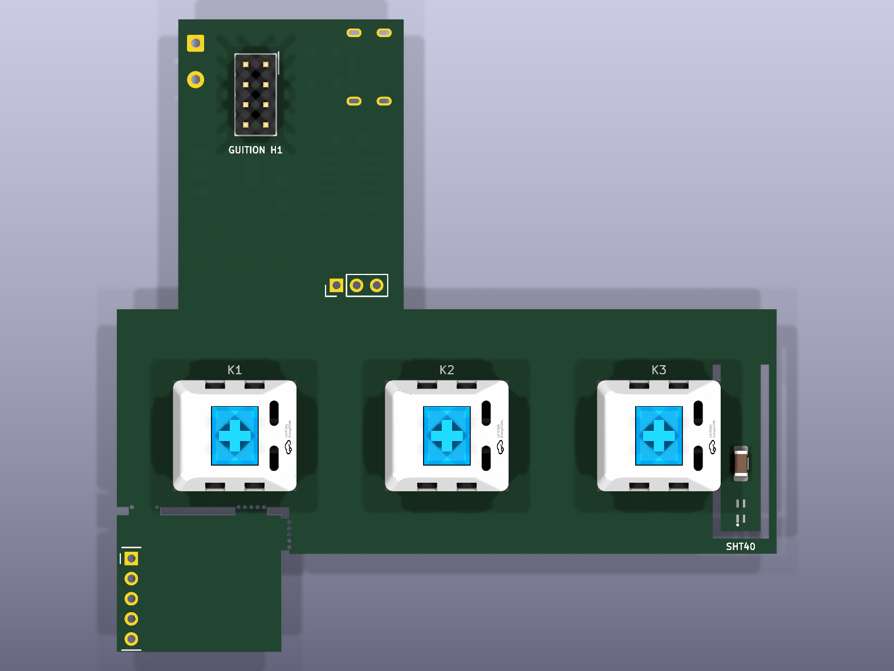
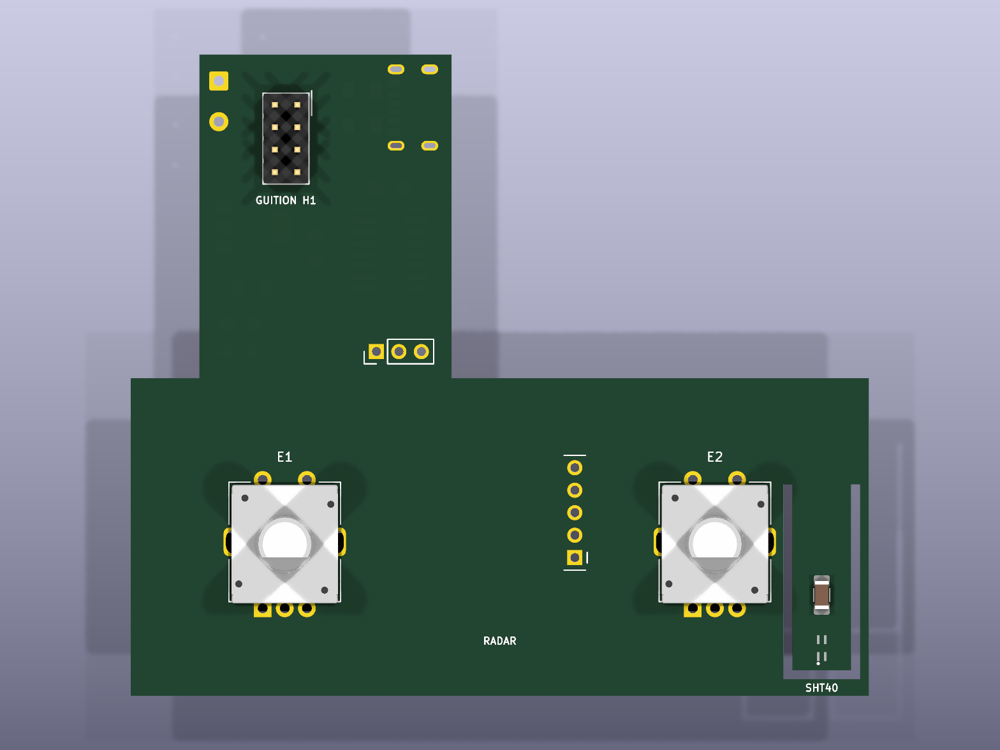
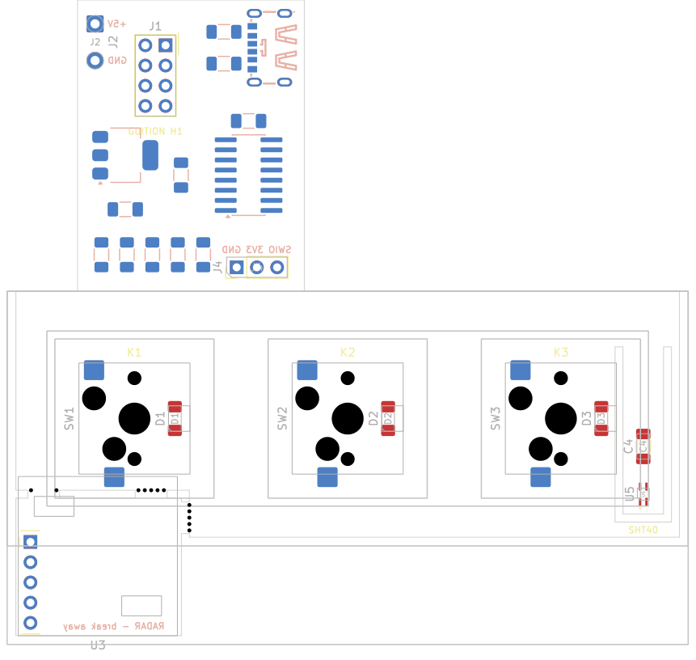
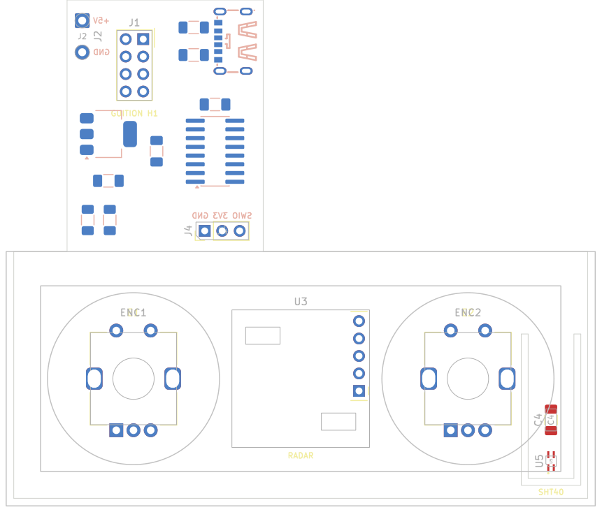

# Add-on boards for the Guition ESP32-S3-4848S040 (rev A, placement only)

Two KiCad 10 projects for a board that plugs into the 2x4 header on the back of the panel (where the 230 V power/relay module would go) and hangs below the display:
- `addon-keys`: three keys.
- `addon-encoders`: two rotary encoders.

They share everything except the bar below the display. Every KiCad file is generated by a script, using the pipeline from the LED controller project (`notes/cheap mcu AC632/rgbw-controller`). Edit the scripts, not the KiCad files, and rerun them.




**Status:** schematics and placement done for both boards, DRC clean apart from the unrouted connections. Not routed yet.
- **From Guition's own files:** the header pinout and the panel size.
- **Measured on a panel:** the header's position. The measurement agrees with a community replacement back cover to about 0.1 mm.
- **Placeholder:** the tab's outline.




The overlays (User.Drawings layer) show the enclosure, its 5 mm border, and the 20 mm keycaps or the 25 mm knobs. The keys board's overlay also shows the enclosure's bottom border with the radar.

## Two boards

Keys and encoders are never fitted together. With the encoders as far apart as the enclosure allows, their pins and tab slots land on the switches' holes and pads in every rotation, about 0.16 mm short at best. So each gets its own board.

- **addon-keys:**
  - Three MX switches (HanElectricity CPG151101D13, clicky) in CPG151101S11-16 hot-swap sockets.
  - A warm-white 1206 LED in each switch's LED slot.
  - The HLK-LD2402 radar on a break-away piece below key 1. Snap it off for a build without the radar.
- **addon-encoders:**
  - Two Bourns PEC11R-4215F-S0024 encoders with push switches, for 25 mm knobs.
  - The radar between them. Leave it off for a build without the radar; there is no piece to snap off.
- **Both:**
  - CH32V003A4M6 co-processor, an I2C slave to the panel.
  - A bare SHT40 on a U-tab at the bar's right end.
  - 3.3 V LDO.
  - 5 V in from solder pads or an optional USB-C. The board feeds 5 V to the panel through the 2x4 header, so the panel's own USB is never connected.

## Board (both)

- **Enclosure (front), as planned:**
  - **Width:** 85.6 mm: the bar plus 1.1 mm walls, which leaves 0.9 mm to each side of the panel.
  - **Border:** 5 mm all round, then a 1 mm gap around each keycap or knob.
  - **Height:** 32 mm for the keys and 37 mm for the encoders, so the border and gap go all round a keycap or a knob. The keys board's enclosure grows to about 44.4 mm with the radar.
- **Bar (front, facing the room):**
  - **Width:** 83.4 mm. Test-fitted, it sat flush with the panel's left edge and 0.9 mm short of its right edge, so it is trimmed 0.9 mm on the left to centre it, plus 1.1 mm on each side for the enclosure walls (2.0 mm left, 1.1 mm right in all).
  - **Height:** 30.9 mm on the keys board and 35.9 mm on the encoders board, ending 1.1 mm above the 5 mm bottom border.
- **SHT40 U-tab:**
  - **Where:** at the bar's right end, beside key 3 or encoder 2.
  - **Shape:** a 1 mm U-shaped slot cuts out a tongue 21 mm long: 5 mm wide on the keys board, 6.6 mm on the encoders board. It hangs from the top and is free at its lower end, near the bottom edge where the enclosure's vents should go.
  - **Parts:** the bare SHT40 near the free end, and C4 (100 nF) on the tongue.
  - **Distance from heat:** far from the regulator, the chip and the radar. On the keys board, key 3's LED, a few milliwatts, is the nearest heat source.
- **Panel:** 86.5 x 86.5 x 13.6 mm, from Guition's dimension drawing.
- **Panel header H1:** a 2x4 female socket with 2.54 mm pitch, its long axis vertical.
  - **Position (measured):** seen from the front, the header body starts 17 mm from the panel's left edge and 22 mm from its bottom edge. With a 5.08 x 10.16 mm body, its centre is 23.71 mm left of and 16.17 mm below the panel's centre.
  - **Cross-check:** the Printables replacement cover 1487412 has its window centred at 23.8 / 16.1 mm.
  - **Pinout (Guition schematic):** 1 GND, 2 GND, 3 IO40 (relay 1), 4 U0RXD, 5 IO2 (relay 2), 6 U0TXD, 7 IO1 (relay 3), 8 5V.
  - **Pin 1:** the top of the column nearer the panel's centre.
  - **No 3.3 V:** H1 has none, so the board has its own regulator.
  - **IO1/IO2/IO40:** they reach H1 through 0 Ω links R25-R27 on the panel. The alternative links R21-R23 route them to the audio amplifier instead.
- **J1:** the male header that plugs into H1. Its footprint numbers each pad like the H1 pin it mates with, so the schematic pin numbers are the panel's. SDA = IO1 (pin 7), SCL = IO2 (pin 5). IO40 and the ESP's UART0 (pins 3, 4, 6) are not used.
- **Tab (behind the panel):**
  - **Size and position:** 28.5 mm wide. Its left edge stays clear of the stock back cover's screw near the panel's lower-left corner (front view, about 37 mm left of and 29 mm below the centre).
  - **Front:** the 2x4 header only.
  - **Back (wall side, inside the wall box):** the USB-C (opening at the tab's right edge), the 5 V wire pads, the LDO, the co-processor, the resistors and the programming pads. Keeping the heat sources here keeps them away from the SHT40.
- **Hand soldering:**
  - 1206 hand-solder pads.
  - SOT-223 regulator.
  - SOIC-16 with pads 0.8 mm longer than standard.
  - Through-hole headers and encoders.
  - The hot-swap socket pads are 2.5 x 2.55 mm.
  - The exception is the bare SHT40, a 1.5 mm DFN with its pads underneath. Its footprint has pads 0.5 mm longer than standard, so it can be tinned and reflowed from outside, but hot air or a hot plate is the reliable way. A small breakout could fit on the tongue instead if you prefer.

## Keys board

- **Keys:** three, spread evenly inside the border, so they are 26.8 mm apart, centred 16 mm below the panel's bottom edge. Switches turned 90 degrees, so the socket pads on the back stay inside each switch's outline and the LED slot faces right.
- **Radar (break-away piece):**
  - **Position:** at the bar's left end, as close to the keys as the switches allow. Its top edge is 0.3 mm below key 1's switch body, so its top 2.7 mm sit behind keycap 1 and the gap around it. The bottom border with the radar shrinks to about 17.4 mm.
  - **Effect of key 1:** key 1's switch stands about 11.6 mm tall right at the radar's top edge. That shades part of its upward view; the forward view isn't affected.
  - **Break line:** steps up under the radar to just below key 1's socket, notching the bar's bottom edge. With the piece snapped off, the notch hides behind the 5 mm border.
  - **Bridges:** three 4 mm bridges with 0.5 mm mouse-bite holes on the bar's edge line, two across the top gap and one across the gap on the piece's right side. They stay clear of key 1's hot-swap socket. The top-left bridge, by the radar's header column, has only its two end holes, and the radar's five tracks cross it between them: score the copper with a knife before snapping.
  - **Orientation:** turned 180 degrees from Hi-Link's figure 6-1, so all five header pins land on the piece; Hi-Link's manual says this orientation is equivalent. The module floats over the notch and the bridges on its 2.5 mm header.
- **SHT40:** sits below the 1 mm gap between keycap 3 and the border.

## Encoders board

- **Encoders:** as far apart as the enclosure allows. Across, it is 5 mm border, 1 mm gap, knob, the space between, knob, 1 mm gap, 5 mm border, so the centres are 18.5 mm in from each end of the enclosure and 48.6 mm apart.
- **Height:** the same from top to bottom, so the enclosure is 37 mm tall and the bar 5 mm taller than the keys board's. The encoders are centred 18.5 mm below the panel's bottom edge, 2.5 mm lower than the keys.
- **Radar:** midway between the encoders and level with them, oriented as in Hi-Link's figure 6-1 (header column on the right). Seen from the front, the knobs clear its sides by about 1.8 mm. Plastic knobs are best; metal ones beside the radar would shade its view to the sides.
- **SHT40:** below and to the right of knob 2, in the enclosure's lower-right corner, with C4 above it. Both are clear of the knob.

## Pin map (CH32V003A4M6)

| Pin | Keys board | Encoders board |
|---|---|---|
| PC1 / PC2 | I2C SDA / SCL to the panel (GPIO1 / GPIO2), 4.7k pull-ups | same |
| PD5 / PD6 | USART1 TX / RX to the radar | same |
| PD4 | radar OUT (presence) | same |
| PC6 / PC7 / PC0 | LED 1 / 2 / 3, PWM on TIM1 CH1-CH3 (remap 1) through 100 R | encoder 1 A / B, encoder 2 A |
| PC3 / PA1 / PC4 | key 1 / 2 / 3 | encoder 1 push / encoder 2 B / encoder 2 push |
| PD1 | SWIO (WCH-LinkE on J4) | same |
| PD7, PA2 | spare | spare |

The two boards use the same pins, so one firmware can serve both. It needs to know which board it's on.

## Parts

| Ref | Part | LCSC | Board |
|---|---|---|---|
| U1 | LDL1117S33R, 3.3 V LDO, SOT-223 | C435835 | both |
| U2 | CH32V003A4M6, SOP-16 | C5346357 | both |
| U3 | HLK-LD2402 radar | | both, optional |
| SW1-SW3 | CPG151101S11-16 hot-swap socket + CPG151101D13 switch | C41430893 + C49234235 | keys |
| D1-D3 | warm-white 1206 LED, 2700-3000 K (LCSC doesn't stock one; e.g. Electrokit 40307556) | | keys |
| R5-R7 | 100 R 1206 | C17901 | keys |
| ENC1, ENC2 | Bourns PEC11R-4215F-S0024 | C143790 | encoders |
| C1, C2 | 10 uF 1206 | C7467044 | both |
| C3 | 100 nF 1206 | C24497 | both |
| R3, R4 | 4.7k 1206 (I2C pull-ups) | C17936 | both |
| J1 | 2x4 male header, 2.54 mm, into the panel's H1 (pin length: see below) | | both |
| J2 | 5 V wire pads | | both |
| J3, R1, R2 | USB-C 6P power-only, 4.7k CC pull-downs (5.1k +-20 %) | C456012, C17936 | both, optional |
| J4 | programming pads: SWIO, 3V3, GND | | not fitted |
| U5 | Sensirion SHT40-AD1B-R2 (I2C 0x44), DFN-4 1.5 x 1.5 mm | C2909890 | both |
| C4 | 100 nF 1206, on the SHT40 tab | C24497 | both |

## Before ordering

- **Header position:** worth a careful second measurement before ordering, since a board-to-board connector leaves no slack. It is set by `HDR_DX` and `HDR_DY` in `place_addon.py`.
- **Panel links:** check that R25-R27 (0 Ω) are fitted on your panels, so IO1 and IO2 actually reach H1. That is likely on relay units and should be checked on ones bought without relays.
- **Pin length:** measure how far H1 sits below the back cover, to choose J1's pin length.
- **Mechanics:** check how the board gets past the frame rim, and the outline.
- **Radar pinout:** check the module's print against 1 VCC, 2 OUT, 3 GND, 4 TX, 5 RX (Hi-Link manual p. 7).
- **Radar header:** the radar's pins must come out of the non-antenna side.
- **LED fit:** check that a 1206 LED fits in the switch's LED slot. From the datasheet the slot is about 9.4 x 2.7 mm.
- **SHT40 soldering:** plan how to solder it: hot air or a hot plate, or have JLCPCB fit just that part.
- **Alignment test:** print `addon-keys/mockup/addon-keys-alignment.stl` or `addon-encoders/mockup/addon-encoders-alignment.stl` (`tools/export_jig_stl.py`), hot-glue a 2x4 header into it and try it on a panel. Its pin holes are opened up for printing: 1.5 mm for the 2.54 mm headers (J1, J4, radar), 1.3 mm for the encoder pins, and the encoder tab slots by 0.2 mm.
- **Routing:** not done yet.
- **Firmware:** still to write: the CH32V003 firmware and the ESPHome component that talks to it.

## Files

| File | What |
|---|---|
| `addon/gen_addon.py` | Schematic for either board (`keys` or `encoders`): parts, values, LCSC numbers, nets |
| `addon/place_addon.py` | Board for either board: outline (with the U-tab, and the keys board's break-away piece), placement, labels, DRC rules, enclosure overlay |
| `addon/sym-lib-table`, `addon/fp-lib-table` | Library tables, copied into each project by `gen_addon.py` |
| `addon-keys/`, `addon-encoders/` | Generated KiCad projects |
| `addon-*/renders/` | 3D renders (top, bottom, angled) and the enclosure overlay |
| `lib/addon.*` | Symbols, footprints and STEP models |
| `tools/addon_lib.py` | Makes the radar symbol and footprint, the hot-swap MX, PEC11R, SHT40 and hand-solder SOIC-16 footprints, the mouse bites, and the USB-C footprint |
| `tools/export_jig_stl.py` | The fit-test STL, with the pin holes opened up for printing |
| `tools/` | schgen, pcbbuild, netcheck, import_lcsc, render3d, from the LED controller project |

## Rebuild

Run from the repo root. `KPY` is KiCad's own Python, used for everything that imports pcbnew. `VENV` is the fablights venv, which has easyeda2kicad.

```bash
KPY="/c/Program Files/KiCad/10.0/bin/python.exe"
CLI="/c/Program Files/KiCad/10.0/bin/kicad-cli.exe"
VENV=/c/Users/englund/Documents/GitHub/fablights/tools/.venv/Scripts/python.exe

"$VENV" hardware/tools/import_lcsc.py C456012 C41430893 C49234235 C143790   # STEP models (once)
python hardware/tools/addon_lib.py                                         # own symbols and footprints
"$CLI" fp upgrade --force hardware/lib/addon.pretty
for B in keys encoders; do
  P=hardware/addon-$B/addon-$B
  python hardware/addon/gen_addon.py $B                                    # schematic
  "$CLI" sch upgrade --force $P.kicad_sch
  python hardware/tools/netcheck.py $P.kicad_sch                           # ERC + single-pin nets
  "$KPY" hardware/addon/place_addon.py $B                                  # board and placement
  "$CLI" pcb drc --schematic-parity --severity-all -o drc-$B.rpt $P.kicad_pcb
  "$KPY" hardware/tools/render3d.py addon-$B                               # renders/
  "$KPY" hardware/tools/export_jig_stl.py $B                               # fit-test STL (git-ignored)
done
```

**Don't run `kicad-cli sym upgrade` on `lib/addon.kicad_sym`:** kicad-cli 10.0.6 then crashes loading any schematic that embeds the upgraded radar symbol.

**Expected DRC result:**
- Unconnected items, because the boards aren't routed: 61 on the keys board, 60 on the encoders board.
- `lib_footprint_issues` (17 and 11), which kicad-cli prints because there's no global footprint library table on this machine.
- Nothing else. Rules in `addon-keys.kicad_dru` allow the keys board's intended overlaps: the LEDs inside the switches, and the radar over key 1's edge and the break line. The encoders board needs none.

## Sources

- Guition's support package for the panel, with the schematic (`5-IO pin distribution/2.png`), the dimension drawing (`3-Structure_Diagram/Dimensions.jpg`) and the spec PDF: <https://pan.jczn1688.com/1/ESP32%20module/4.0inch_ESP32-4848S040.zip>
- Header position measured on a panel and cross-checked against the Printables replacement back cover 1487412; board photos at <https://homeding.github.io/boards/esp32s3/panel-4848S040.htm>
- Hi-Link HLK-LD2402 manual (pins p. 7, drawing p. 37, orientation pp. 33-35): <https://www.manualslib.com/manual/4392645/Hi-Link-Hlk-Ld2402.html>
- Bourns PEC11R datasheet: <https://www.bourns.com/docs/Product-Datasheets/PEC11R.pdf>
- HanElectricity CPG151101D13 and CPG151101S11-16 drawings, from LCSC (C49234235, C41430893)
